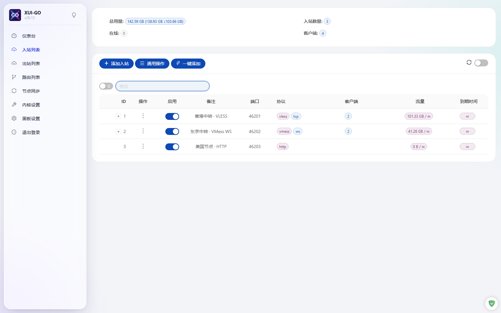

# X-UI 1.11.4 定制版

基于 [alireza0/x-ui](https://github.com/alireza0/x-ui) v1.11.4 的定制分支，遵循 GPLv3。


> **免责声明：** 本项目仅供个人学习与通信使用，请勿用于任何非法用途，不建议直接用于生产环境。

## 相对上游的主要改动

| 项目 | 说明 |
| --- | --- |
| 界面语言 | 仅保留中文 / English，默认强制中文；不再根据浏览器 `Accept-Language` 自动切换，只认语言 cookie |
| 默认时区 | `Asia/Hong_Kong`（新建数据库生效；导入旧库后可在设置页修改） |
| 管理脚本 | `x-ui.sh` 全菜单汉化，安装 / 更新 / 重装地址全部指向本仓库 |
| Xray 版本 | 默认安装 `v26.6.27`；可在面板首页的版本弹窗中切换其他版本（列表最低 `v26.4.25`，离线时回退为默认版本） |
| 出站列表 | 与入站一致的分页 + 全字段搜索（tag、协议、地址、端口、settings/streamSettings 内容） |
| SQLite | WAL + `synchronous=NORMAL` + `busy_timeout=10s` + `txlock=IMMEDIATE`；`cache_size` 按内存自动（感知 cgroup，可用环境变量覆盖）；连接池 4/2（空闲 3 分钟回收）；`client_traffics.inbound_id` 索引；备份前 checkpoint，导入时清理 WAL sidecar |

> SQLite 调优参数由程序在启动时施加，不存储在数据库文件中，因此导入其他数据库不会覆盖这些参数；导入只会带回 settings 表中的业务配置（时区、TG 语言、分页大小等）。

## 快速概览

| 功能 | 支持 |
| --- | :---: |
| 多协议 | :heavy_check_mark: |
| 中 / 英双语（默认中文） | :heavy_check_mark: |
| 多客户端 / 多入站 | :heavy_check_mark: |
| 高级流量路由界面 | :heavy_check_mark: |
| 客户端 / 流量 / 系统状态 | :heavy_check_mark: |
| 按首次使用时间计算到期与流量上限 | :heavy_check_mark: |
| REST API | :heavy_check_mark: |
| Telegram 机器人（数据库备份 + 管理 + 客户端查询） | :heavy_check_mark: |
| 订阅服务（链接 + 信息） | :heavy_check_mark: |
| 深度搜索 | :heavy_check_mark: |
| 深色 / 浅色主题 | :heavy_check_mark: |
| 客户端 IP 限制（仅 Linux，依赖 nftables） | :heavy_check_mark:* |

## 安装与升级

```sh
bash <(curl -Ls https://raw.githubusercontent.com/rrkai/xui-go/main/install.sh)
```

安装指定版本（版本号格式如 `v26.13`，即 2026 年第 13 次发布；不指定版本时安装 `releases/latest`）：

```sh
VERSION=v26.13 && bash <(curl -Ls https://raw.githubusercontent.com/rrkai/xui-go/main/install.sh) $VERSION
```

- 安装脚本从本仓库的 `releases/latest` 下载 `x-ui-linux-<arch>.tar.gz`。
- 全新安装会自动生成随机面板端口（50000-59999）、WebBasePath 与用户名/密码，并在安装结束时打印，请妥善保存。WebBasePath 为 9 位混合字符（2 数字 + 3 小写 + 4 大写，排除 0/1、o/O、l/L、i/I 等易混字符）。

## 手动安装与升级

<details>
  <summary>展开查看</summary>

1. 安装依赖（安装脚本会自动处理，手动安装时需要）：

```sh
# Debian / Ubuntu
apt-get update && apt-get install -y wget curl tar tzdata cron ca-certificates nftables
# CentOS / Alma / Rocky / Fedora
# yum install -y wget curl tar tzdata cronie ca-certificates nftables
# Arch / Manjaro
# pacman -Syu --noconfirm wget curl tar tzdata cronie ca-certificates nftables
```

> `ca-certificates` 用于 HTTPS/TLS，`nftables` 是客户端 IP 限制功能所需。

2. 下载最新发布包：

```sh
ARCH=$(uname -m)
case "${ARCH}" in
  x86_64 | x64 | amd64) XUI_ARCH="amd64" ;;
  i*86 | x86) XUI_ARCH="386" ;;
  armv8* | armv8 | arm64 | aarch64) XUI_ARCH="arm64" ;;
  armv7* | armv7) XUI_ARCH="armv7" ;;
  *) XUI_ARCH="amd64" ;;
esac

wget https://github.com/rrkai/xui-go/releases/latest/download/x-ui-linux-${XUI_ARCH}.tar.gz
```

3. 安装或升级：

```sh
systemctl stop x-ui 2>/dev/null || true
cp /etc/x-ui/x-ui.db /root/x-ui.db.bak.$(date +%F-%H%M) 2>/dev/null || true
tar zxvf x-ui-linux-${XUI_ARCH}.tar.gz
chmod +x x-ui/x-ui x-ui/bin/xray-linux-* x-ui/x-ui.sh
cp -f x-ui/x-ui.sh /usr/bin/x-ui
cp -f x-ui/x-ui.service /etc/systemd/system/
rm -rf /usr/local/x-ui
mv x-ui /usr/local/
systemctl daemon-reload
systemctl enable x-ui
systemctl restart x-ui
```

</details>

## Docker 部署

仓库自带 `Dockerfile`。注意：`docker-compose.yml` 中的 `image` 仍指向上游镜像，使用前请改为本地构建，或直接使用下面的命令。

```sh
git clone https://github.com/rrkai/xui-go.git
cd xui-go
docker build -t x-ui .

mkdir -p db cert
docker run -itd \
    --name x-ui --restart=unless-stopped --network host \
    -e XRAY_VMESS_AEAD_FORCED=false \
    -v $PWD/db/:/etc/x-ui/ \
    -v $PWD/cert/:/root/cert/ \
    --cap-add NET_ADMIN \
    x-ui
```

## 语言

- 中文（默认，强制）
- English

## 功能特性

- 支持 VLESS、VMess、Trojan、Shadowsocks、Dokodemo-door、SOCKS、HTTP、Wireguard 等协议
- 支持 XTLS，包括 Vision 与 REALITY
- 高级流量路由界面：PROXY Protocol、Reverse、External、Transparent Proxy，以及多域名、SSL 证书、端口配置
- 支持通过 Wireguard 出站自动生成 Cloudflare WARP
- 可视化 JSON 编辑器，编辑 Xray 模板配置
- 入站 / 出站高级配置界面
- 客户端流量上限与到期时间可按首次使用时间起算
- 按客户端限制并发 IP 数（nftables，仅 Linux）
- 在线客户端、流量统计、系统状态监控
- 数据库深度搜索
- 展示已耗尽（过期或超流量）的客户端
- 订阅服务（多链接）
- 数据库导入 / 导出
- 全新安装自动申请面板 IP 证书（Let's Encrypt，约 6 天有效，自动续期）
- 面板安全：证书状态、公网 80 端口检测、Let's Encrypt / ZeroSSL 切换、临时释放 80 端口
- 同端口 HTTP/HTTPS 自适应：证书有效时 HTTP 自动跳转 HTTPS，证书缺失或过期时保留 HTTP 入口
- 面板与订阅服务的 HTTPS 访问（自有域名 + 证书）
- 深色 / 浅色主题

## 界面预览




## API 路由

<details>
  <summary>展开查看</summary>

- `/login`，`POST` 用户数据：`{username: '', password: ''}`
- `/xui/API/inbounds`：

| 方法 | 路径 | 说明 |
| :---: | --- | --- |
| `GET` | `"/"` | 获取全部入站 |
| `GET` | `"/get/:id"` | 按 id 获取入站 |
| `POST` | `"/add"` | 添加入站 |
| `POST` | `"/del/:id"` | 删除入站 |
| `POST` | `"/update/:id"` | 更新入站 |
| `POST` | `"/addClient/"` | 向入站添加客户端 |
| `POST` | `"/:id/delClient/:clientId"` | 按 clientId 删除客户端* |
| `POST` | `"/updateClient/:clientId"` | 按 clientId 更新客户端* |
| `GET` | `"/getClientTraffics/:email"` | 按邮箱获取客户端流量 |
| `GET` | `"/getClientTrafficsById/:id"` | 按 ID 获取客户端流量 |
| `POST` | `"/:id/resetClientTraffic/:email"` | 重置客户端流量 |
| `POST` | `"/resetAllTraffics"` | 重置所有入站流量 |
| `POST` | `"/resetAllClientTraffics/:id"` | 重置入站客户端流量（-1 表示全部） |
| `POST` | `"/delDepletedClients/:id"` | 删除入站耗尽客户端（-1 表示全部） |
| `POST` | `"/import"` | 从导出数据导入入站 |
| `POST` | `"/onlines"` | 获取在线用户（邮箱列表） |

\* `clientId` 取值：VMess/VLESS 用 `client.id`，Trojan 用 `client.password`，Shadowsocks 用 `client.email`。

- `/xui/API/outbounds`：

| 方法 | 路径 | 说明 |
| :---: | --- | --- |
| `GET` | `"/"` | 获取全部出站 |
| `POST` | `"/add"` | 添加出站 |
| `POST` | `"/del/:id"` | 删除出站 |
| `POST` | `"/update/:id"` | 更新出站 |
| `POST` | `"/setFirst/:id"` | 将出站移到列表首位 |
| `POST` | `"/:id/resetTraffic"` | 重置出站流量 |
| `POST` | `"/resetAllTraffics"` | 重置所有出站流量 |
| `POST` | `"/onlines"` | 获取在线出站 tag |
| `POST` | `"/test"` | 测试出站连通性 |
| `POST` | `"/reverseTags"` | 获取客户端 reverse tag（可作为 dialer） |

- `/xui/API/routing`：

| 方法 | 路径 | 说明 |
| :---: | --- | --- |
| `GET` | `"/"` | 获取全部路由规则 |
| `GET` | `"/refs"` | 获取路由引用（tag 与元数据） |
| `POST` | `"/save"` | 保存路由规则 |
| `POST` | `"/replaceBalancerTag"` | 替换路由规则中的 balancer tag |

- `/xui/API/server`：

| 方法 | 路径 | 说明 |
| :---: | --- | --- |
| `GET` | `"/status"` | 获取服务器状态 |
| `GET` | `"/certStatus"` | 获取面板证书状态 |
| `GET` | `"/certPortCheck"` | 检测公网 80 端口可用性（`?target=...&force=1`） |
| `POST` | `"/certIssue"` | 申请或更新面板证书 |
| `POST` | `"/certOptions"` | 设置临时释放 80 端口选项 |
| `GET` | `"/getDb"` | 下载数据库备份 |
| `GET` | `"/createbackup"` | 让 Telegram 机器人向管理员发送备份 |
| `GET` | `"/getConfigJson"` | 获取 config.json |
| `GET` | `"/getXrayVersion"` | 获取可切换的 Xray 版本列表（离线时回退为默认版本） |
| `GET` | `"/getNewVlessEnc"` | 生成新的 VLESS 加密参数 |
| `GET` | `"/getNewX25519Cert"` | 生成新的 X25519 证书 |
| `GET` | `"/getNewmldsa65"` | 生成新的 mldsa65 密钥 |
| `POST` | `"/getNewEchCert"` | 生成新的 ECH 证书 |
| `POST` | `"/getCertHash"` | 计算证书哈希 |
| `POST` | `"/getTlsPing"` | 通过 TLS ping 获取哈希 |
| `POST` | `"/importDB"` | 导入数据库 |
| `POST` | `"/stopXrayService"` | 停止 Xray |
| `POST` | `"/restartXrayService"` | 重启 Xray |
| `POST` | `"/installXray/:version"` | 安装并切换到指定版本 Xray |
| `POST` | `"/logs/:count"` | 获取面板 / Xray 日志 |

</details>

## 环境变量

| 变量 | 类型 | 默认值 |
| --- | :---: | --- |
| `XUI_LOG_LEVEL` | `"debug"` \| `"info"` \| `"warn"` \| `"error"` | `"info"` |
| `XUI_DEBUG` | `boolean` | `false` |
| `XUI_BIN_FOLDER` | `string` | `"bin"` |
| `XUI_DB_FOLDER` | `string` | `"/etc/x-ui"` |
| `XUI_SQLITE_CACHE_SIZE` | `int64`：负数 = KiB/连接，正数 = 页数/连接 | 按内存自动 |

## SQLite 调优说明

面板默认启用 WAL 与并发优化，全部在启动时施加，无需手动改库：

| 参数 | 值 |
| --- | --- |
| `journal_mode` | `WAL` |
| `synchronous` | `NORMAL`（WAL 下的安全/性能折中） |
| `busy_timeout` | `10000` ms |
| `txlock` | `IMMEDIATE`（避免先读后写事务在 WAL 下升级失败） |
| `cache_size` | 自动：≤512MB 内存 `-4000`，≤1GB `-8000`，>1GB `-16000`（KiB/连接，cgroup 限制生效） |
| 连接池 | 最大 4，空闲 2，空闲 3 分钟回收 |
| 索引 | `client_traffics.inbound_id`（自动补建） |

启动日志（syslog / journald）会输出实际取值，例如：

```text
INFO - sqlite: cache_size= -16000  source= auto  memory_limit_mb= 3921
```

可用 `XUI_SQLITE_CACHE_SIZE` 覆盖，例如 `XUI_SQLITE_CACHE_SIZE=-8000`。

### 备份与导入

- 请使用面板的“导出数据库”：导出前会执行 `wal_checkpoint(TRUNCATE)`，确保备份完整。
- 不要直接复制正在运行的 `x-ui.db`：最新数据可能还在 `-wal` 文件中。
- 导入会整库替换，并自动清理旧 `-wal/-shm`、执行迁移、补建索引；导入的 settings（时区、TG 语言、分页大小等）会随备份恢复，导入后按需调整。

## SSL 证书

<details>
  <summary>展开查看</summary>

### 自动证书（面板安全）

全新安装会自动尝试申请面板 IP 证书（Let's Encrypt，约 6 天有效）。之后可在 **面板设置 → 面板安全** 中查看状态、检测或临时释放 80 端口、申请与更换证书。

- 仅支持 HTTP-01，公网必须能访问 80 端口；NAT 机型需先做端口映射，否则会提示不可申请。
- 到期前 12 小时开始续期，失败每 30 分钟重试；证书过期后域名会自动切换供应商，连续失败 3 次则放弃并回退 HTTP。
- IP 证书仅 Let's Encrypt 支持；域名可使用 Let's Encrypt 或 ZeroSSL（需 EAB 凭据）。
- 续期成功后证书在 10 秒内热加载，不重启面板和 Xray。
- 自动管理的证书保存在 `/root/xui-https/`。

### Cloudflare（推荐）

管理脚本内置 Cloudflare 证书申请。需要：

- Cloudflare 注册邮箱
- Cloudflare Global API Key
- 域名已通过 Cloudflare 解析到当前服务器

在服务器上执行 `x-ui`，选择菜单 **19（Cloudflare SSL 证书）**，按提示输入即可。

### Certbot

```bash
snap install core; snap refresh core
snap install --classic certbot
ln -s /snap/bin/certbot /usr/bin/certbot

certbot certonly --standalone --register-unsafely-without-email --non-interactive --agree-tos -d <你的域名>
```

</details>

## Telegram 机器人

<details>
  <summary>展开查看</summary>

面板支持通过 Telegram 机器人发送每日流量、登录通知、数据库备份、系统状态、客户端信息等。需要在面板设置中配置：

- Telegram Token
- 管理员 Chat ID（可多个）
- 通知时间（cron 表达式）
- 数据库备份开关
- CPU 负载阈值通知

**Crontab 时间格式示例**

- `*/30 * * * *` - 每 30 分钟通知
- `30 * * * * *` - 每分钟第 30 秒通知
- `0 */10 * * * *` - 每 10 分钟通知
- `@hourly` - 每小时
- `@daily` - 每天 00:00
- `@every 8h` - 每 8 小时

### 功能

- 定时报表
- 登录通知
- CPU 负载阈值通知
- 到期时间与流量预警
- 按 Telegram ID 或用户名查询客户端
- 匿名流量查询（按 UUID / 密码搜索）
- 菜单式交互
- 管理员按邮箱搜索客户端
- 入站检查
- 系统状态检查
- 耗尽客户端检查
- 按需备份与定时备份
- 多语言（本版本默认中文）

</details>

## 常见问题

<details>
  <summary>展开查看</summary>

### 客户端流量统计不生效

如果从旧版本或其他分支升级，客户端流量可能默认未开启。检查 Xray 模板中的 `policy` 段，确保包含：

```json
"policy": {
  "levels": {
    "0": {
      "statsUserUplink": true,
      "statsUserDownlink": true
    }
  },
  "system": {
    "statsInboundDownlink": true,
    "statsInboundUplink": true
  }
},
```

保存后重启 Xray 服务。

### 导入原版数据库后时区变成 Asia/Tehran

时区保存在 settings 表中，会随导入的库恢复。到“设置”页改为 `Asia/Hong_Kong` 即可；SQLite 调优参数不受影响。

</details>

## 致谢

- 上游项目：[alireza0/x-ui](https://github.com/alireza0/x-ui)（GPLv3）
- [Loyalsoldier/v2ray-rules-dat](https://github.com/Loyalsoldier/v2ray-rules-dat)（GPL-3.0）
- [Iran v2ray rules](https://github.com/chocolate4u/Iran-v2ray-rules)（GPL-3.0）
- [HexaSoftwareTech](https://github.com/HexaSoftwareTech/)、[MHSanaei](https://github.com/MHSanaei)

## 许可证

本项目遵循 **GPLv3**。分发或修改后分发时，请保留许可证并公开对应源码。
