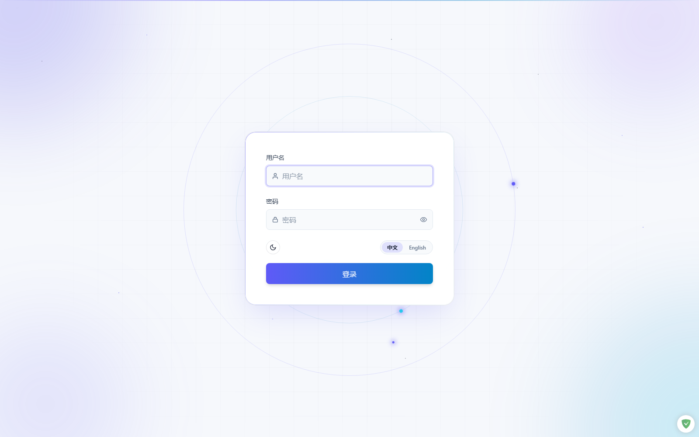
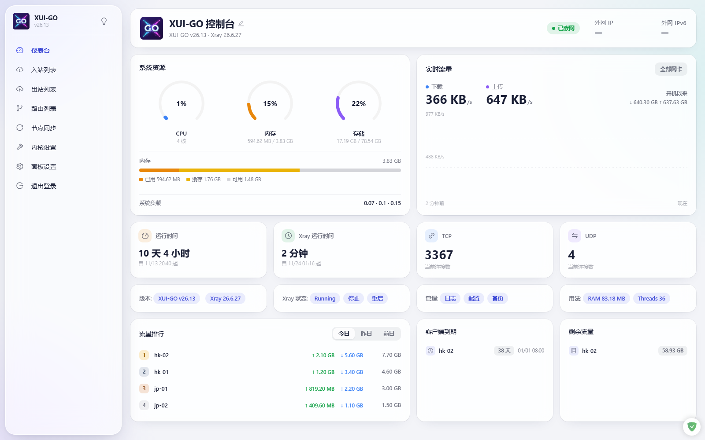
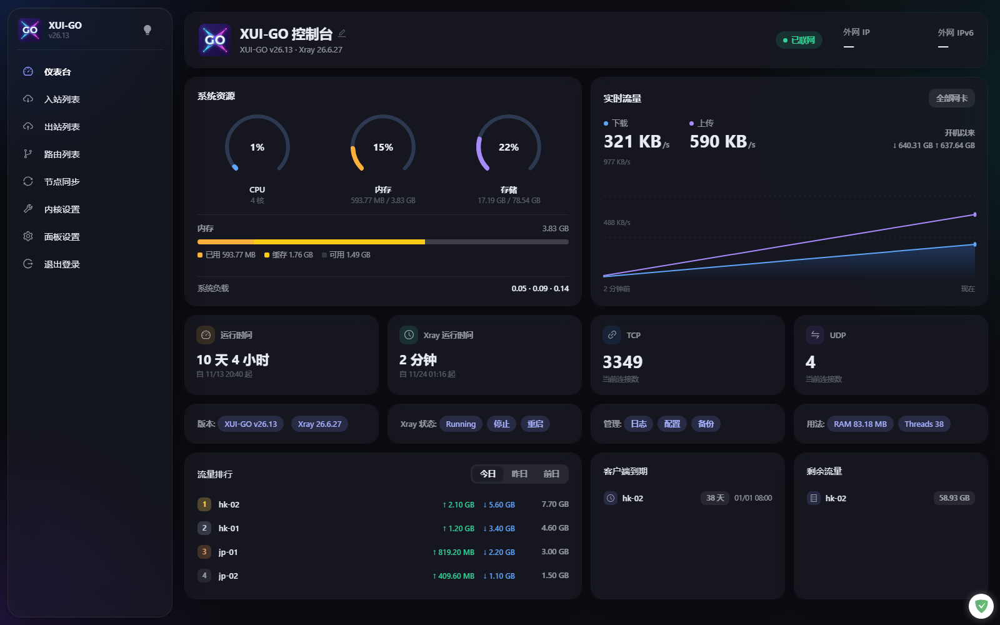
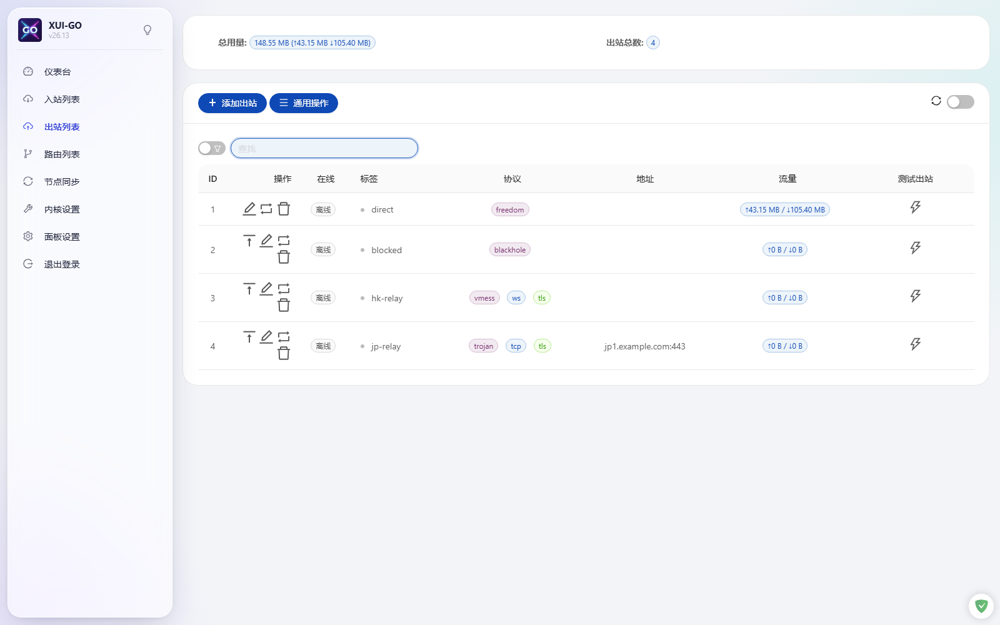
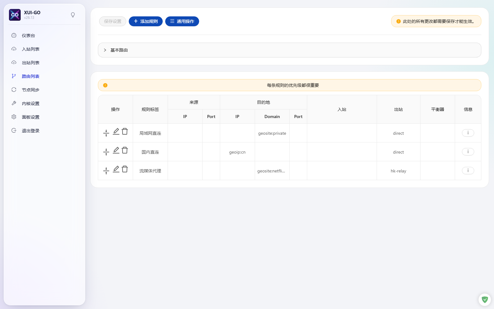
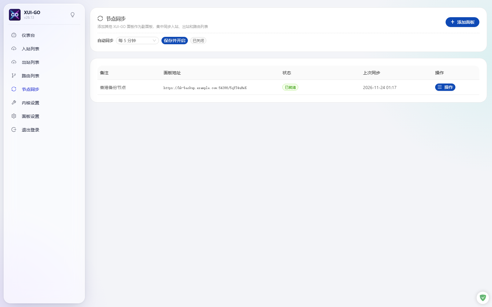
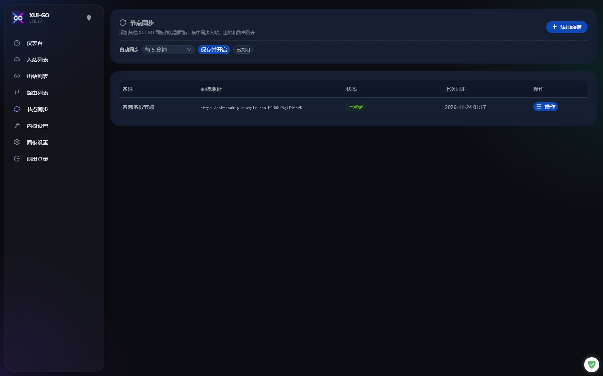
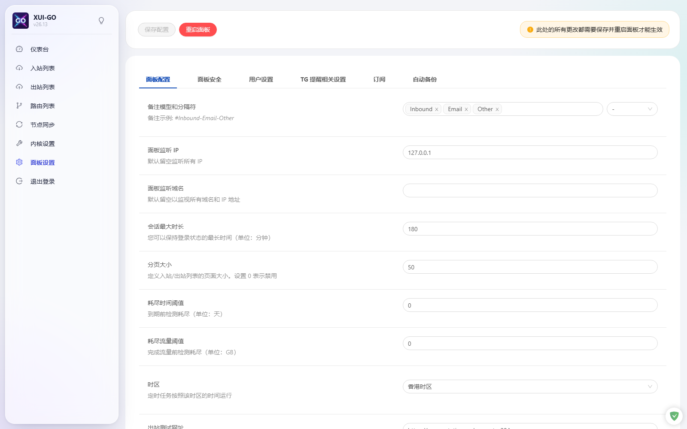

# XUI-GO 面板


> **免责声明：** 本项目仅供个人学习与通信使用，请勿用于任何非法用途，不建议直接用于生产环境。

## 功能一览

### 节点同步

- 对等双向同步：把其他 XUI-GO 面板添加为对端，双向合并入站、出站和路由列表
- 三方合并：每个对端保存上次同步基线，按基线与两端数据做 diff，新增、修改、删除都能传播
- 冲突处理：同一 tag 两边都改时以改动更晚的一方为准，时间相同按面板标识破平局，两端结果一致
- 安全门控：新添加的对端必须先检查一次；检查通过前不会同步，编辑地址或账号后需要重新检查
- 时间一致性：两端面板时区必须一致、时钟偏差不超过 60 秒，否则拒绝同步；时区不一致可就地“对齐时区”
- 串行同步：多台时按列表顺序逐个同步，链式逐跳传播，间隔内最终一致
- 热加载：按 tag 差异增删，路由通过 Xray API 热更新，正常同步不重启内核、不断现有连接
- 被动对端：被对方添加并首次收到推送时自动登记，可在列表中查看和删除
- 对端名称：列表显示对端仪表台顶部的主机名（面板名称为空时用系统主机名），对端改名后下次检查 / 同步自动刷新
- 同步日志：每行提供日志入口，查看该对端最近 100 条记录（同步结果与耗时、检查状态变化、时区对齐、被动端收到推送），删除对端时一并清除
- 自动同步：5 / 10 / 30 / 60 分钟或 24 小时，只对已检查通过的对端执行，与手动同步互斥
- 状态实时检测：面板地址错误 / 用户名密码错误 / 面板连接超时 / 时区不一致 / 时间偏差过大 / 对端标识不一致，具体原因悬停可见
- 节点密码使用面板 secret 派生密钥 AES-GCM 加密存储；编辑面板信息时可直接查看已保存的密码（明文）

### 面板与界面

- 中 / 英双语，默认中文（只认语言 Cookie，不跟随浏览器 `Accept-Language`）
- 深色 / 浅色主题，页面加载动画跟随当前主题，不会先白闪再变黑
- 面板标题：仪表台顶部名称可点击修改，浏览器标签页与登录页的标题同步使用该名称
- 时区下拉预设：本机时区 / 香港时区 / 新加坡时区 / 德国柏林时区 / 洛杉矶时区 / 纽约时区 / 日韩时区；新库默认本机时区
- 入站 / 出站列表分页与全字段搜索（tag、协议、地址、端口、settings / streamSettings 内容）
- 入站限速：按入站端口限制上行 / 下行速率（Mbps，0 = 不限），nftables 即时生效；改限速不重启 Xray、不影响其他入站，限速随节点同步（仅 Linux）
- 订阅服务（多链接）、客户端流量与到期限制、按首次使用时间起算、IP 限制（nftables，仅 Linux）
- 用户证书：菜单“用户证书”集中放置面板安全证书与用户密码修改两个页卡；面板设置只保留常规配置、TG 提醒、订阅与自动备份
- 自动备份：本地目录 / WebDAV / FTP / S3 兼容存储（Cloudflare R2、Backblaze B2、MinIO、阿里云 OSS、AWS S3，SigV4），按保留数量自动清理旧备份
- Telegram 机器人：定时报表、登录通知、负载告警、客户端查询、数据库备份

### 运维与更新

- 面板内在线更新：显示进度，完成后按版本号自动刷新；失败直接提示退出码，可重试，日志见 `/var/log/x-ui-update.log`
- 在线切换 Xray 版本：默认 `v26.6.27`，最低 `v26.4.25`，离线时回退默认版本
- 管理脚本 `x-ui` 全菜单汉化，安装 / 更新地址全部指向本仓库
- SQLite 启动调优：WAL、`synchronous=NORMAL`、`busy_timeout=10s`、`txlock=IMMEDIATE`，`cache_size` 按内存自动
- 面板证书自动化：全新安装自动申请 IP 证书（Let's Encrypt，约 6 天有效，自动续期），支持 ZeroSSL（域名需 EAB）
- 同端口 HTTP / HTTPS 自适应：证书有效时 HTTP 自动跳转 HTTPS，证书缺失或过期时保留 HTTP 入口

## 界面预览











## 安装与升级

```sh
bash <(curl -Ls https://raw.githubusercontent.com/rrkai/xui-go/main/install.sh)
```

安装指定版本（版本号格式如 `v26.14`，即 2026 年第 14 次发布；不指定版本时安装 `releases/latest`）：

```sh
VERSION=v26.14 && bash <(curl -Ls https://raw.githubusercontent.com/rrkai/xui-go/main/install.sh) $VERSION
```

- 安装脚本从本仓库的 `releases/latest` 下载 `x-ui-linux-<arch>.tar.gz`。
- 全新安装会自动生成随机面板端口（50000-59999）、WebBasePath 与用户名/密码，并在安装结束时打印，请妥善保存。WebBasePath 为 9 位混合字符（2 数字 + 3 小写 + 4 大写，排除 0/1、o/O、l/L、i/I 等易混字符）。

## 手动安装与升级

<details>
  <summary>展开查看</summary>

1. 安装依赖（安装脚本会自动处理，手动安装时需要）：

```sh
# Debian / Ubuntu
apt-get update && apt-get install -y wget curl tar tzdata cron ca-certificates nftables
# CentOS / Alma / Rocky / Fedora
# yum install -y wget curl tar tzdata cronie ca-certificates nftables
# Arch / Manjaro
# pacman -Syu --noconfirm wget curl tar tzdata cronie ca-certificates nftables
```

> `ca-certificates` 用于 HTTPS/TLS，`nftables` 是客户端 IP 限制功能所需。

2. 下载最新发布包：

```sh
ARCH=$(uname -m)
case "${ARCH}" in
  x86_64 | x64 | amd64) XUI_ARCH="amd64" ;;
  i*86 | x86) XUI_ARCH="386" ;;
  armv8* | armv8 | arm64 | aarch64) XUI_ARCH="arm64" ;;
  armv7* | armv7) XUI_ARCH="armv7" ;;
  *) XUI_ARCH="amd64" ;;
esac

wget https://github.com/rrkai/xui-go/releases/latest/download/x-ui-linux-${XUI_ARCH}.tar.gz
```

3. 安装或升级：

```sh
systemctl stop x-ui 2>/dev/null || true
cp /etc/x-ui/x-ui.db /root/x-ui.db.bak.$(date +%F-%H%M) 2>/dev/null || true
tar zxvf x-ui-linux-${XUI_ARCH}.tar.gz
chmod +x x-ui/x-ui x-ui/bin/xray-linux-* x-ui/x-ui.sh
cp -f x-ui/x-ui.sh /usr/bin/x-ui
cp -f x-ui/x-ui.service /etc/systemd/system/
rm -rf /usr/local/x-ui
mv x-ui /usr/local/
systemctl daemon-reload
systemctl enable x-ui
systemctl restart x-ui
```

</details>

## Docker 部署

仓库自带 `Dockerfile`，本地构建后运行：

```sh
git clone https://github.com/rrkai/xui-go.git
cd xui-go
docker build -t x-ui .

mkdir -p db cert
docker run -itd \
    --name x-ui --restart=unless-stopped --network host \
    -e XRAY_VMESS_AEAD_FORCED=false \
    -v $PWD/db/:/etc/x-ui/ \
    -v $PWD/cert/:/root/cert/ \
    --cap-add NET_ADMIN \
    x-ui
```

## 节点同步使用说明

### 角色与方向

- 没有主副概念：任何面板都可以添加其他 XUI-GO 面板作为对端，添加方需要能登录对端。
- 同步由添加方发起：每轮先拉取对端数据，合并后写回本面板，再把合并结果推给对端；数据始终双向流动。
- 被添加的一方在第一次收到推送时自动登记为“被动对端”（无密码、不主动同步），可查看和删除。
- 只支持 XUI-GO 面板，两端版本都需要 ≥ v26.15。
- 节点列表位于菜单 **路由列表 → 节点同步**。

### 添加与检查

1. 点击“添加对端”，填写对端地址（带 WebBasePath）、用户名和密码，备注可选。
2. 添加时会登录验证并记录对端面板标识，但**不会开始同步**，状态为“待检查”。
3. 点击“检查”：校验版本、面板标识、时区与时钟；通过后状态变为“已就绪”，才能手动或自动同步。
4. 修改地址、账号或密码后需要重新检查；对端重装导致面板标识变化时，需要删除后重新添加。

### 时间要求

- 两端面板的时区设置必须一致（设置页“时区”），不一致会拒绝同步并提示双方的时区。
- 时区不一致时，节点状态旁会出现“对齐时区”按钮：把对端面板的时区设置改为与本面板一致（不改对端系统时间），完成后自动重新检查；添加对端后检查失败也会直接给出该按钮。
- 两端的系统时间偏差必须 ≤ 60 秒，建议开启 NTP；偏差过大同样拒绝同步，这类偏差无法通过面板修改，需要在系统层校准。
- 冲突裁决与“上次同步时间”都以面板自己的时钟和时区为准，所以两端必须同区、同时。

### 同步

- “立即同步”针对单个对端；“同步全部”按列表顺序串行处理所有已就绪对端。
- 每轮结果展示入站 / 出站 / 路由的新增、更新、删除条数以及热加载状态；两端没有变化时不写库、不碰 Xray。
- 合并规则：
  - 只有一边改动（新增、修改、删除）时采用改动的一边；
  - 两边改成相同内容时视为一致；
  - 两边改成不同内容时，改动时间更晚的一方胜出，时间相同按面板标识字典序破平局；
  - 删除同样带时间戳，删除与编辑对撞时同样“后改的胜”；
  - 入站端口冲突时保留较新的一条并给出警告；
  - 出站与路由按 Sort 排序并重新编号，保证两端顺序一致。
- 入站 / 出站 / 路由采用热加载：按 tag 差异增删，路由通过 Xray API 热更新；仅当 API 失败时标记待重启，由后台兜底重载。
- 客户端流量计数按邮箱保留，不参与同步（本地计数不清零、不合并）。

### 自动同步

- 页面选择频率并点击“保存并开启”：默认 5 分钟，可选 10 / 30 / 60 分钟或 24 小时。
- 只对已检查通过的对端执行；未检查或检查未通过的对端会被跳过。
- 自动同步与手动同步互斥，多对端按列表顺序串行执行。

### 状态说明

页面打开、添加 / 编辑、检查或同步结束后都会检测对端：

| 状态 | 含义 |
| --- | --- |
| 面板地址错误 | 地址无法访问、目标不是 XUI-GO 面板；悬停可看具体原因 |
| 用户名密码错误 | 登录被对端拒绝，检查用户名 / 密码 |
| 面板连接超时 | 网络不可达或响应超时 |
| 时区不一致 | 两端面板时区设置不同；点状态旁的“对齐时区”把对端改成本面板时区，或在设置页手动改 |
| 时间偏差过大 | 两端系统时间相差超过 60 秒 |
| 对端标识不一致 | 对端重装或换机导致面板标识变化，需要删除后重新添加 |
| 对端版本过低 | 对端版本低于 v26.15，需要先升级 |

“待检查”表示已添加但还没有通过检查，此时不会同步。

### 列表与日志

- “主机名”列显示对端仪表台顶部名称：对端设置过面板名称时用面板名称，否则用系统主机名。对端改名后，本端在下次检查或同步时自动更新（打开页面就会检查一次）。
- 每行“日志”按钮查看该对端的同步记录，倒序展示最近 100 条，按对端独立保存：
  - 手动 / 自动同步结果：本端应用和对端应用分别列出各类新增、更新、删除数量与热加载状态，附警告、耗时；
  - 检查状态变化：从“已就绪”变为检查失败，或重新检查通过；
  - 时区对齐操作；
  - 被动对端收到推送的记录。
- 删除对端时会一并删除它的日志。

### 通过 API 触发同步

适合用 API 批量增删改入站、出站、路由的自动化场景：改完后额外调用一次同步接口即可。

```sh
BASE="https://你的面板:端口/你的WebBasePath"
curl -sk -c cookie.txt -X POST "$BASE/login" -d "username=用户名&password=密码"

# 查询对端列表（含 id、peerTitle、passive、ready、lastSync）
curl -sk -b cookie.txt "$BASE/xui/API/node_sync/nodes"

# 查看对端同步日志（最近 100 条，倒序）
curl -sk -b cookie.txt "$BASE/xui/API/node_sync/logs/6"

# 向全部已就绪对端同步一次
curl -sk -b cookie.txt -X POST "$BASE/xui/API/node_sync/sync"

# 只向指定对端同步（id 来自 nodes 接口）
curl -sk -b cookie.txt -X POST "$BASE/xui/API/node_sync/sync/6"

# 兼容旧接口：/push 与 /push/:id 等同于 /sync 与 /sync/:id
curl -sk -b cookie.txt -X POST "$BASE/xui/API/node_sync/push"
```

返回示例：

```json
{"success":true,"msg":"同步成功","obj":{
  "total":1,"succeeded":1,"failed":0,
  "items":[{"id":6,"remark":"香港备份节点","success":true,"changed":true,
    "localChanged":true,"peerChanged":true,"hotReload":true,"peerHotReload":true,
    "inbounds":{"added":1,"updated":0,"deleted":0},
    "peerInbounds":{"added":0,"updated":1,"deleted":0},
    "outbounds":{"added":0,"updated":0,"deleted":0},
    "peerOutbounds":{"added":0,"updated":0,"deleted":0},
    "routingRules":{"added":0,"updated":0,"deleted":0},
    "peerRoutingRules":{"added":0,"updated":0,"deleted":0},
    "warnings":[],"lastSync":1795454239,"lastSyncText":"2026-11-24 17:28"}]}}
```

- `inbounds` / `outbounds` / `routingRules` 是本端应用（写库）的变更计数，`peerInbounds` / `peerOutbounds` / `peerRoutingRules` 是对端应用的变更计数；`localChanged` / `peerChanged` 分别表示本端、对端本轮是否实际应用了变更。
- 部分对端失败不影响其他对端，失败原因见 `items[].message`。
- 全部失败或没有已就绪的对端时 `success` 为 `false`。
- 撞上自动同步正在执行时，接口最多等待 10 秒重试。

### 注意事项

- 同步以入站为最小合并单位：同一入站内两边各改不同客户端时，后改的一条会整条覆盖另一条。
- 流量计数、面板访问配置（端口 / WebBasePath / 证书 / 登录账号）不同步。
- 被动对端不主动同步；删除后若对方仍持有本面板登录凭据并再次同步，会自动重新登记。
- 节点密码使用面板 secret 派生密钥加密存储，接口不回传密码；编辑时显示已保存的密码明文。
- 旧版主副接口（初始化 / 下发 / 合并 / 覆盖主库）在新版返回升级提示，不再执行。

## 面板在线更新

- 首页出现“有更新”后，点击更新并在弹窗确认即可；也可用 SSH 执行 `x-ui update`。
- 面板内更新会在临时 systemd 单元中执行，更新完成后按面板版本号判断，页面自动刷新，不再停留在“正在更新”。
- 更新失败会直接显示退出码并允许重试，排查日志：`/var/log/x-ui-update.log`。
- 数据目录与数据库在更新后保留。
- 同一版本号的重新发布不会触发更新提示（版本号相同），需要更新时手动执行一次 `x-ui update`。

## 面板标题与外观

### 面板标题

- 仪表台顶部的名称可直接点击编辑（最长 64 字符），保存后作为面板名称。
- 浏览器标签页标题为“面板名称 - 页面名称”，登录页同样使用该名称。
- 名称为空时回退为服务器主机名；修改后标签页立即更新，无需刷新。

### 时区

- 设置页提供下拉预设，按顺序：本机时区 / 香港时区 / 新加坡时区 / 德国柏林时区 / 洛杉矶时区 / 纽约时区 / 日韩时区。
- “本机时区”自动读取宿主系统时区；自定义时区值会保留显示。
- 新数据库默认“本机时区”（读取宿主系统时区）；修改时区后需重启面板生效。

### 语言

- 中文（默认，强制）与 English。
- 语言选择只认 Cookie，不跟随浏览器 `Accept-Language`。

### 主题

- 深色 / 浅色主题可手动切换。
- 页面加载遮罩与动画会跟随当前主题，深色下不会出现白底闪烁。

## REST API

所有接口位于面板的 WebBasePath 之下，例如 `/5qYT4uHwK/xui/API/...`。鉴权方式为会话 Cookie：先 `POST /login` 登录，后续请求携带该 Cookie。

- `/login`，`POST` 用户数据：`{username: '', password: ''}`

- `/xui/API/inbounds`：

| 方法 | 路径 | 说明 |
| :---: | --- | --- |
| `GET` | `"/"` | 获取全部入站 |
| `GET` | `"/get/:id"` | 按 id 获取入站 |
| `POST` | `"/add"` | 添加入站 |
| `POST` | `"/del/:id"` | 删除入站 |
| `POST` | `"/update/:id"` | 更新入站 |
| `POST` | `"/addClient/"` | 向入站添加客户端 |
| `POST` | `"/:id/delClient/:clientId"` | 按 clientId 删除客户端* |
| `POST` | `"/updateClient/:clientId"` | 按 clientId 更新客户端* |
| `GET` | `"/getClientTraffics/:email"` | 按邮箱获取客户端流量 |
| `GET` | `"/getClientTrafficsById/:id"` | 按 ID 获取客户端流量 |
| `POST` | `"/:id/resetClientTraffic/:email"` | 重置客户端流量 |
| `POST` | `"/resetAllTraffics"` | 重置所有入站流量 |
| `POST` | `"/resetAllClientTraffics/:id"` | 重置入站客户端流量（-1 表示全部） |
| `POST` | `"/delDepletedClients/:id"` | 删除入站耗尽客户端（-1 表示全部） |
| `POST` | `"/import"` | 从导出数据导入入站 |
| `POST` | `"/onlines"` | 获取在线用户（邮箱列表） |

\* `clientId` 取值：VMess/VLESS 用 `client.id`，Trojan 用 `client.password`，Shadowsocks 用 `client.email`。

- `/xui/API/outbounds`：

| 方法 | 路径 | 说明 |
| :---: | --- | --- |
| `GET` | `"/"` | 获取全部出站 |
| `POST` | `"/add"` | 添加出站 |
| `POST` | `"/del/:id"` | 删除出站 |
| `POST` | `"/update/:id"` | 更新出站 |
| `POST` | `"/setFirst/:id"` | 将出站移到列表首位 |
| `POST` | `"/:id/resetTraffic"` | 重置出站流量 |
| `POST` | `"/resetAllTraffics"` | 重置所有出站流量 |
| `POST` | `"/onlines"` | 获取在线出站 tag |
| `POST` | `"/test"` | 测试出站连通性 |
| `POST` | `"/reverseTags"` | 获取客户端 reverse tag（可作为 dialer） |

- `/xui/API/routing`：

| 方法 | 路径 | 说明 |
| :---: | --- | --- |
| `GET` | `"/"` | 获取全部路由规则 |
| `GET` | `"/refs"` | 获取路由引用（tag 与元数据） |
| `POST` | `"/save"` | 保存路由规则 |
| `POST` | `"/replaceBalancerTag"` | 替换路由规则中的 balancer tag |

- `/xui/API/node_sync`：

| 方法 | 路径 | 说明 |
| :---: | --- | --- |
| `GET` | `"/nodes"` | 查询对端列表、面板标识、时区与自动同步频率 |
| `POST` | `"/sync"` | 向全部已检查的对端同步一次 |
| `POST` | `"/sync/:id"` | 只向指定对端同步 |
| `POST` | `"/push"` | 兼容旧接口，等同于 `/sync` |
| `POST` | `"/push/:id"` | 兼容旧接口，等同于 `/sync/:id` |

- `/xui/API/server`：

| 方法 | 路径 | 说明 |
| :---: | --- | --- |
| `GET` | `"/status"` | 获取服务器状态 |
| `GET` | `"/certStatus"` | 获取面板证书状态 |
| `GET` | `"/certPortCheck"` | 检测公网 80 端口可用性（`?target=...&force=1`） |
| `POST` | `"/certIssue"` | 申请或更新面板证书 |
| `POST` | `"/certOptions"` | 设置临时释放 80 端口选项 |
| `GET` | `"/getDb"` | 下载数据库备份 |
| `GET` | `"/createbackup"` | 让 Telegram 机器人向管理员发送备份 |
| `GET` | `"/getConfigJson"` | 获取 config.json |
| `GET` | `"/getXrayVersion"` | 获取可切换的 Xray 版本列表（离线时回退为默认版本） |
| `GET` | `"/getNewVlessEnc"` | 生成新的 VLESS 加密参数 |
| `GET` | `"/getNewX25519Cert"` | 生成新的 X25519 证书 |
| `GET` | `"/getNewmldsa65"` | 生成新的 mldsa65 密钥 |
| `POST` | `"/getNewEchCert"` | 生成新的 ECH 证书 |
| `POST` | `"/getCertHash"` | 计算证书哈希 |
| `POST` | `"/getTlsPing"` | 通过 TLS ping 获取哈希 |
| `POST` | `"/importDB"` | 导入数据库 |
| `POST` | `"/stopXrayService"` | 停止 Xray |
| `POST` | `"/restartXrayService"` | 重启 Xray |
| `POST` | `"/installXray/:version"` | 安装并切换到指定版本 Xray |
| `POST` | `"/logs/:count"` | 获取面板 / Xray 日志 |

## 环境变量

| 变量 | 类型 | 默认值 |
| --- | :---: | --- |
| `XUI_LOG_LEVEL` | `"debug"` \| `"info"` \| `"warn"` \| `"error"` | `"info"` |
| `XUI_DEBUG` | `boolean` | `false` |
| `XUI_BIN_FOLDER` | `string` | `"bin"` |
| `XUI_DB_FOLDER` | `string` | `"/etc/x-ui"` |
| `XUI_SQLITE_CACHE_SIZE` | `int64`：负数 = KiB/连接，正数 = 页数/连接 | 按内存自动 |

## SQLite 调优与备份

面板默认启用 WAL 与并发优化，全部在启动时施加，无需手动改库：

| 参数 | 值 |
| --- | --- |
| `journal_mode` | `WAL` |
| `synchronous` | `NORMAL`（WAL 下的安全/性能折中） |
| `busy_timeout` | `10000` ms |
| `txlock` | `IMMEDIATE`（避免先读后写事务在 WAL 下升级失败） |
| `cache_size` | 自动：≤512MB 内存 `-4000`，≤1GB `-8000`，>1GB `-16000`（KiB/连接，cgroup 限制生效） |
| 连接池 | 最大 4，空闲 2，空闲 3 分钟回收 |
| 索引 | `client_traffics.inbound_id`（自动补建） |

启动日志（journald）会输出实际取值，例如：

```text
INFO - sqlite: cache_size= -16000  source= auto  memory_limit_mb= 3921
```

可用 `XUI_SQLITE_CACHE_SIZE` 覆盖，例如 `XUI_SQLITE_CACHE_SIZE=-8000`。

### 备份与导入

- 请使用面板的“导出数据库”：导出前会执行 `wal_checkpoint(TRUNCATE)`，确保备份完整。
- 自动备份支持本地目录、WebDAV、FTP 和 S3 兼容存储；S3 需填 Endpoint、Region、Bucket、Access Key、Secret Key，可选对象前缀。AWS 自动使用虚拟主机寻址，R2 / B2 / MinIO / OSS 使用路径寻址。
- 不要直接复制正在运行的 `x-ui.db`：最新数据可能还在 `-wal` 文件中。
- 导入会整库替换，并自动清理旧 `-wal/-shm`、执行迁移、补建索引；导入的 settings（时区、TG 语言、分页大小等）会随备份恢复，导入后按需调整。
- SQLite 调优参数由程序在启动时施加，不存储在数据库文件中，导入其他数据库不会覆盖这些参数。

## SSL 证书

<details>
  <summary>展开查看</summary>

### 自动证书（面板安全证书）

全新安装会自动尝试申请面板 IP 证书（Let's Encrypt，约 6 天有效）。之后可在 **用户证书 → 面板安全证书** 中查看状态、检测或临时释放 80 端口、申请与更换证书。

- 仅支持 HTTP-01，公网必须能访问 80 端口；NAT 机型需先做端口映射，否则会提示不可申请。
- 到期前 12 小时开始续期，失败每 30 分钟重试；证书过期后域名会自动切换供应商，连续失败 3 次则放弃并回退 HTTP。
- IP 证书仅 Let's Encrypt 支持；域名可使用 Let's Encrypt 或 ZeroSSL（需 EAB 凭据）。
- 证书安装、更换或续期后立即热加载（外部替换文件最迟 10 秒内生效），不重启面板和 Xray；证书有效时 HTTP 访问自动跳转 HTTPS，证书过期或缺失时保留 HTTP 入口。
- 自动管理的证书保存在 `/root/xui-https/`。

### Cloudflare

管理脚本内置 Cloudflare 证书申请。需要 Cloudflare 注册邮箱、Global API Key，以及已解析到当前服务器的域名。在服务器上执行 `x-ui`，选择菜单 **19（Cloudflare SSL 证书）**，按提示输入即可。

### Certbot

```bash
snap install core; snap refresh core
snap install --classic certbot
ln -s /snap/bin/certbot /usr/bin/certbot

certbot certonly --standalone --register-unsafely-without-email --non-interactive --agree-tos -d <你的域名>
```

</details>

## Telegram 机器人

<details>
  <summary>展开查看</summary>

面板支持通过 Telegram 机器人发送每日流量、登录通知、数据库备份、系统状态、客户端信息等。需要在面板设置中配置：

- Telegram Token
- 管理员 Chat ID（可多个）
- 通知时间（cron 表达式）
- 数据库备份开关
- CPU 负载阈值通知

**Crontab 时间格式示例**

- `*/30 * * * *` - 每 30 分钟通知
- `30 * * * * *` - 每分钟第 30 秒通知
- `0 */10 * * * *` - 每 10 分钟通知
- `@hourly` - 每小时
- `@daily` - 每天 00:00
- `@every 8h` - 每 8 小时

### 功能

- 定时报表、登录通知、CPU 负载阈值通知
- 到期时间与流量预警
- 按 Telegram ID 或用户名查询客户端、按 UUID / 密码匿名查询
- 管理员按邮箱搜索客户端、入站检查、系统状态检查、耗尽客户端检查
- 按需备份与定时备份
- 菜单式交互，多语言（默认中文）

</details>

## 常见问题

<details>
  <summary>展开查看</summary>

### 升级后页面样式错乱或标题没变

浏览器缓存了旧脚本。使用 Ctrl+F5 强制刷新一次；面板标题修改后标签页会立即更新，但已打开的其它页面需要刷新才会带上新名称。

### 同一版本看不到更新提示

版本号相同不会触发面板内更新提示（例如重新发布的同版本包）。需要时在服务器执行一次 `x-ui update`，或在面板中手动安装同版本包。

### 在线更新失败

弹窗会显示更新器退出码。查看 `/var/log/x-ui-update.log` 定位原因，修复后重新点击更新；也可以直接 SSH 执行 `x-ui update`。

### 节点同步一直提示某个状态

状态包括面板地址错误、用户名密码错误、面板连接超时、时区不一致、时间偏差过大、对端标识不一致和对端版本过低，鼠标悬停可看到具体原因。时区或时间问题需要在两端调整面板时区与系统时间后重新检查；对端标识不一致通常是重装或换机，删除后重新添加即可。

### 客户端流量统计不生效

如果从旧版本升级，客户端流量可能默认未开启。检查 Xray 模板中的 `policy` 段，确保包含：

```json
"policy": {
  "levels": {
    "0": {
      "statsUserUplink": true,
      "statsUserDownlink": true
    }
  },
  "system": {
    "statsInboundDownlink": true,
    "statsInboundUplink": true
  }
},
```

保存后重启 Xray 服务。

### 导入数据库后时区不对

时区保存在 settings 表中，会随导入的库恢复。到“设置”页改为需要的时区（含“本机时区”）并重启面板即可；SQLite 调优参数不受影响。

</details>

## 许可证

本项目遵循 **GPLv3**。基础框架源自 [alireza0/x-ui](https://github.com/alireza0/x-ui)（GPLv3），随包的 `geoip.dat` / `geosite.dat` 来自 Xray-core 发布。分发或修改后分发时，请保留许可证并公开对应源码。